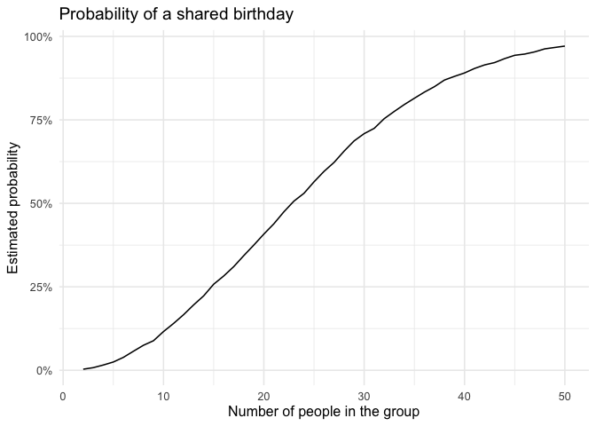

P8105 Homework 5
================
Yihui Luo

``` r
has_shared_birthday <- function(group_size) {
  birthdays <- sample(1:365, size = group_size, replace = TRUE)
  any(duplicated(birthdays))
}
```

``` r
set.seed(123)

birthday_results <- tibble::tibble(
  group_size = 2:50,
  probability = purrr::map_dbl(
    group_size,
    function(n) mean(replicate(10000, has_shared_birthday(n)))
  )
)
```

``` r
library(ggplot2)

ggplot(birthday_results, aes(x = group_size, y = probability)) +
  geom_line() +
  scale_y_continuous(labels = scales::label_percent()) +
  labs(
    title = "Probability of a shared birthday",
    x = "Number of people in the group",
    y = "Estimated probability"
  ) +
  theme_minimal(base_size = 12)
```

<!-- -->

``` r
dplyr::filter(birthday_results, group_size %in% c(23, 50))
```

    ## # A tibble: 2 × 2
    ##   group_size probability
    ##        <int>       <dbl>
    ## 1         23       0.507
    ## 2         50       0.971

The estimated probability that at least two people share a birthday
increases with group size. It reaches 50.7% with just 23 people and
rises to 97.1% with 50 people.
